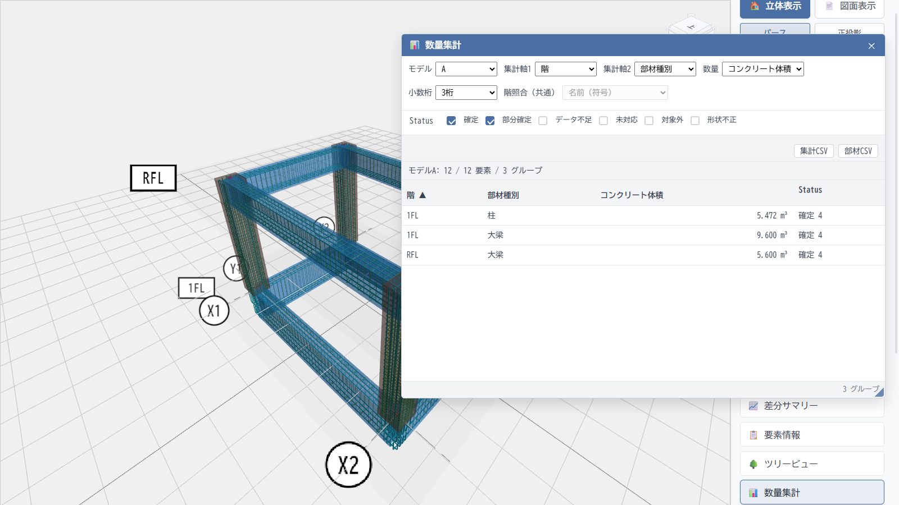

# 数量集計

ST-Bridgeモデルの部材情報から数量を算出し、設計モデルの内訳を一覧で確認できます。モデルAとBを読み込めば、2つのモデルの数量差を同じ集計軸で見比べられます。

## 画面例

階と部材種別で集計した例です。数量集計パネルで各グループの値を確認しながら、背後の3Dモデルで対象部材の位置を把握できます。

## 主な機能

- 階、部材種別、構造種別、断面から集計軸を選び、2段階まで組み合わせて表示できます。
- 件数、長さ、面積、総体積、正味体積、コンクリート体積、鉄骨体積を切り替えられます。A/B比較では各モデルの値と差分（B−A）を表示します。
- 集計行から対象部材の一覧を開き、個別の部材を3Dビューや要素情報で確認できます。
- 集計結果と部材ごとの数量を、それぞれCSVで書き出せます。

## 使い方

STBモデルを読み込んで「📊 数量集計」を開き、モデル、集計軸、数量の種類を選びます。2モデルの差を確認するときは「A/B比較」に切り替えます。

数量には「確定」「部分確定」「データ不足」などの状態が付きます。部分確定の値は確定値と分けて表示されるため、元データの不足や未対応項目を確認しながら集計できます。鉄筋量は集計項目に含まれません。
