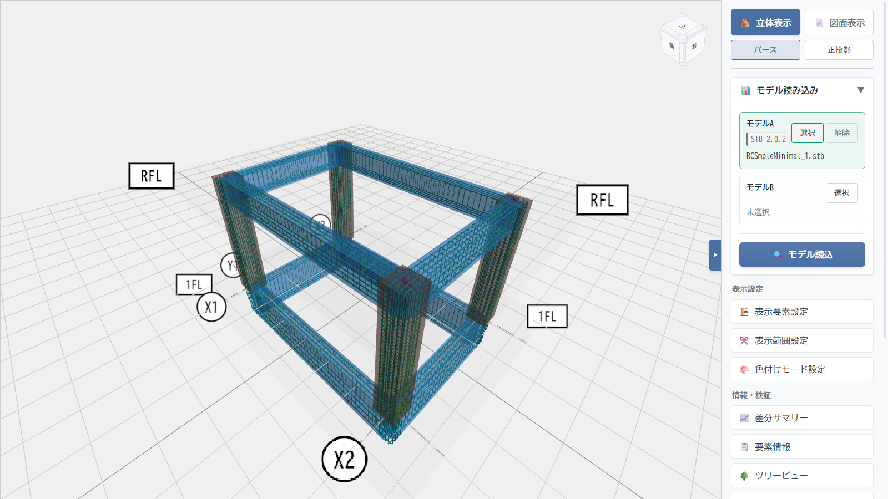

# 鉄筋生成

ST-Bridgeの断面・配筋情報をもとに鉄筋の3D形状を生成し、躯体と重ねて表示します。図面や数値だけでは追いにくい鉄筋の位置関係や納まりを、モデルを回転・拡大しながら確認できます。

## 画面例

柱と大梁の鉄筋表示を有効にした例です。主筋や帯筋・あばら筋の配置を、躯体との位置関係を含めて確認できます。

## 主な機能

- 柱、大梁、小梁、場所打ち杭の主筋と帯筋・あばら筋を表示できます。スラブ、壁、基礎、布基礎の主筋表示にも対応しています。
- 部材種別ごとに表示を切り替え、径ごとに色を設定できます。鉄筋選択モードでは、選んだ鉄筋の種別や呼び径を確認できます。
- 「鉄筋生成設定」で、主筋中心位置がSTBにない場合に用いるかぶり値や配筋納まりの選択肢を設定できます。
- 定着・カットオフの確認一覧と配筋判断トレースから、採用したルールや未解決の理由を追えます。

## 使い方

STBモデルを読み込んだ後、表示設定の各部材行にある「鉄筋」をオンにします。配置条件を調整する場合は「🧱 鉄筋生成設定を開く」を選びます。

STBには鉄筋の3D位置が含まれないため、表示形状はSTBの情報と設定から構成した想定配置です。最終的な配筋・施工納まりは設計図書と照合してください。
