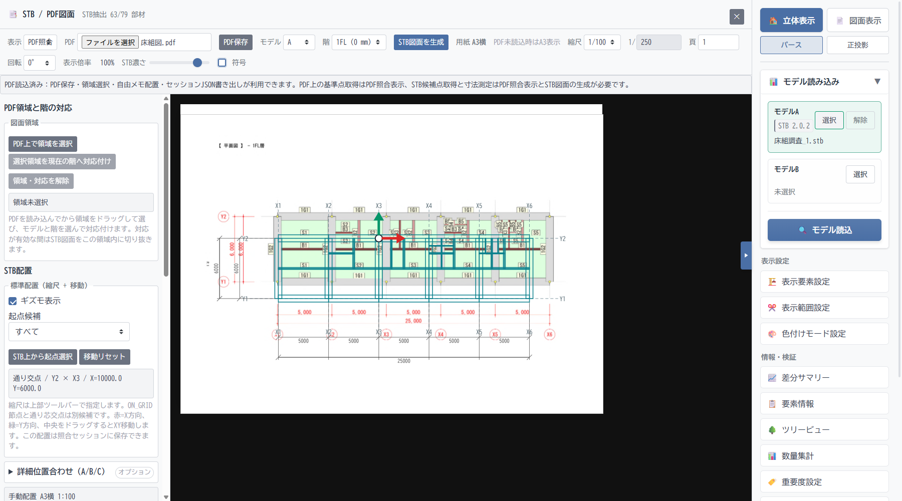

# SVGのPDF重ね合わせ

ST-Bridgeモデルから生成した階平面図をSVGで描き、読み込んだPDF図面の上に重ねて表示します。モデルと図面の位置・形状を同じ画面で見比べ、部材ごとの照合結果を記録できます。

## 画面例

1FLのPDF平面図に、STBから生成したSVG図面を重ねた例です。青緑の線がSTB図面で、縮尺と配置を調整しながら背景のPDF図面と照合できます。

## 主な機能

- モデルA/Bと階を選び、STB図面を生成できます。PDFを読み込まない場合もA3横の図面として表示できます。
- PDFのページ・回転を選び、縮尺と移動ギズモでSTB図面を位置合わせできます。必要に応じて基準点を使った詳細位置合わせも可能です。
- PDF上の図面領域を階に対応付け、重ねる範囲を絞れます。STBの濃さや符号表示も調整できます。
- 部材ごとに「未確認」「確認済み」「不一致」を記録し、メモを付けられます。図面上の自由メモ、STB輪郭線を使った寸法測定、照合セッションのJSON保存にも対応します。
- 表示中ページの重ね合わせと注記を含むPDFを、別名で保存できます。

## 使い方

STBモデルを読み込んで「📑 STB / PDF図面」を開き、モデルと階を選んで「STB図面を生成」を押します。PDFを読み込んだら「PDF照合」に切り替え、縮尺とギズモで図面を合わせます。

重ね合わせは目視照合を支援する機能で、自動的に一致・不一致を判定するものではありません。PDF保存では元PDFの全ページを再描画するため、元のベクター図形やテキスト構造は保持されません。
